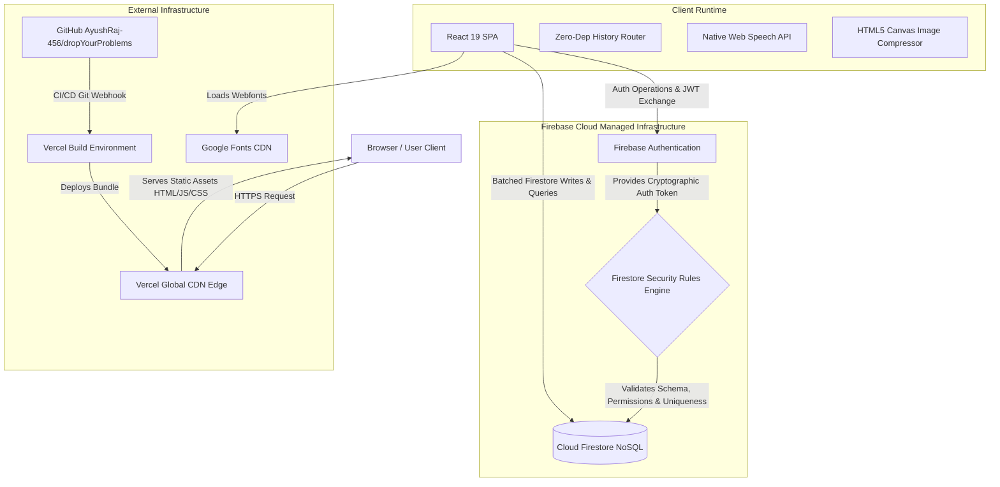
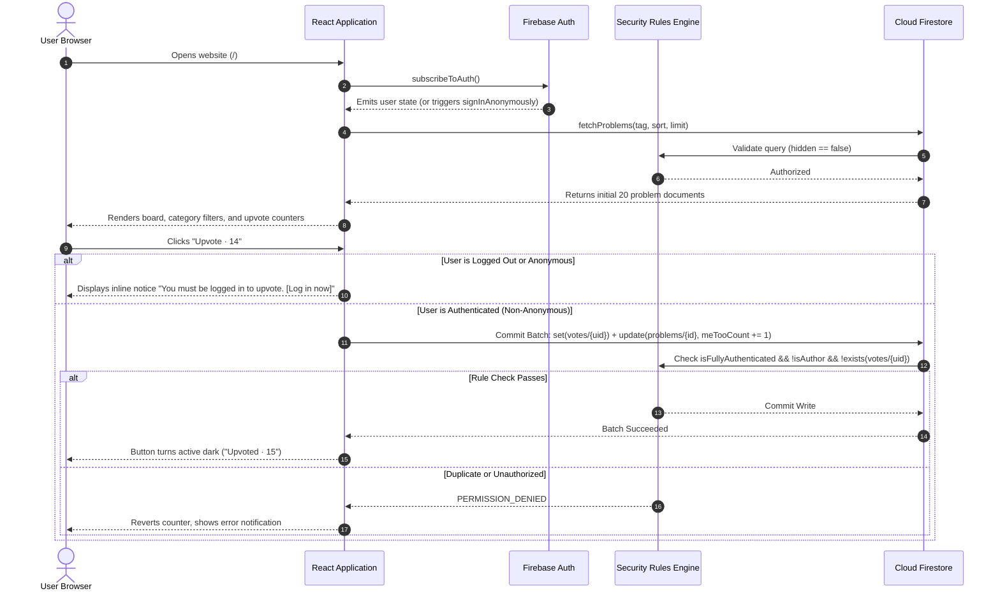

# Complete System Architecture: Drop Your Problems

---

## 1. High-Level Architecture Overview

**Drop Your Problems** employs a modern **Jamstack / Serverless BaaS (Backend-as-a-Service)** architecture. 

Rather than maintaining a custom Node.js, Express, or Django server that requires continuous server provisioning, OS patching, process managers (PM2), and scaling configurations, the application combines:
1. A compiled, static React Single Page Application (SPA) delivered via a global High-Performance Content Delivery Network (**Vercel Edge Network**).
2. A managed backend provided by **Google Firebase** (**Cloud Firestore** for schemaless, transactional data persistence, and **Firebase Authentication** for identity management).
3. **Firestore Security Rules Engine** as the server-side gatekeeper and business logic validator, eliminating the need for intermediary API endpoints for standard CRUD operations.

---

## 2. System Components & Responsibilities

### 2.1. Client-Side Single Page Application (SPA)
- **Technology:** React 19, Vite 8, Vanilla CSS Design System.
- **Role:** Handles presentation, user input capture, form state, optimistic UI updates, speech recognition transcription, image cropping, and client navigation.
- **Information Sent:** Query parameters (tags, sorting), problem creation payloads, batched vote operations, base64-encoded profile photos.
- **Information Received:** Paginated problem documents, authentication state changes, contributor records.

### 2.2. Zero-Dependency Client Router ([src/utils/router.jsx](file:///c:/Users/Ayush/Desktop/Codes/drop_your_Problem/src/utils/router.jsx))
- **Role:** Manages client-side URL routing (`/`, `/login`, `/me`, `/admin`, `/contributors`, `404`) without the heavyweight overhead of third-party routing libraries like `react-router-dom`.
- **Mechanism:** Intercepts click events, modifies browser history via `window.history.pushState`, and listens to `popstate` events.

### 2.3. Vercel Hosting & CDN Infrastructure
- **Role:** Hosts the built static files (`dist/index.html`, JavaScript chunks, CSS stylesheets, SVGs).
- **Edge Routing ([vercel.json](file:///c:/Users/Ayush/Desktop/Codes/drop_your_Problem/vercel.json)):** Enforces an SPA rewrite rule (`/(.*) -> /index.html`), ensuring that deep links (such as `/login` or `/admin`) resolve to the single-page application without 404 errors.

### 2.4. Firebase Authentication Service
- **Role:** Issues secure, cryptographically signed JSON Web Tokens (JWTs).
- **Supported Identity Providers:**
  1. **Anonymous Auth:** Generated silently on first visit to assign an ephemeral `uid` for rate limiting and post attribution.
  2. **Google OAuth 2.0:** Secure federated identity provider via popup.
  3. **Passwordless Email Link:** Sends cryptographic one-time sign-in links to user email inboxes.
- **Account Linking:** Allows anonymous users to convert into permanent Google/Email accounts while retaining problem ownership.

### 2.5. Cloud Firestore Database
- **Role:** Multi-region, horizontally scaled NoSQL document database.
- **Collections Structure:**
  - `problems/{problemId}`: Stores all submitted problems, categories, vote tallies, report tallies, and moderation flags.
  - `problems/{problemId}/votes/{voterUid}`: Deterministic subcollection tracking individual voter IDs to prevent duplicate voting.
  - `problems/{problemId}/reports/{reporterUid}`: Subcollection tracking individual problem reports.
  - `contributors/{problemId}`: Stores milestone contributor cards for problems reaching $\ge 10$ upvotes.
  - `admins/{uid}`: Protected whitelist collection identifying administrator accounts.
  - `userStats/{uid}`: Ephemeral timestamp document enforcing a 30-second posting cooldown.

### 2.6. Cloud Firestore Security Rules Engine ([firestore.rules](file:///c:/Users/Ayush/Desktop/Codes/drop_your_Problem/firestore.rules))
- **Role:** Acts as the decentralized backend application server.
- **Validation Responsibilities:**
  - Enforces schema types, string lengths, and valid tag enums.
  - Rejects upvote attempts from unauthenticated or anonymous accounts.
  - Prohibits self-upvoting by problem authors.
  - Ensures atomic counters increment by exactly $+1$.
  - Enforces duplicate vote prevention via subcollection document existence checks.
  - Validates contributor eligibility against verified problem upvote counts ($\ge 10$).

---

## 3. Component Interaction Diagram

---

## 4. Hardware and Network Architecture

| Boundary | Provider | Protocol | Performance SLA / Limits |
| :--- | :--- | :--- | :--- |
| **Static Delivery** | Vercel Edge CDN | HTTP/2, HTTPS (TLS 1.3) | Global Anycast DNS, sub-50ms asset delivery |
| **Data & Auth** | Google Cloud (Firestore / Auth) | gRPC / WebSocket / HTTPS | Automatic multi-region replication, 99.99% availability |
| **Client Assets** | Google Fonts CDN | HTTP/2, HTTPS | Cached typography (Manufacturing Consent, Josefin Sans) |
| **Client Audio** | Local Web Speech Engine | Local OS API (SAPI / CoreSpeech) | Zero latency, offline capable on supporting operating systems |
